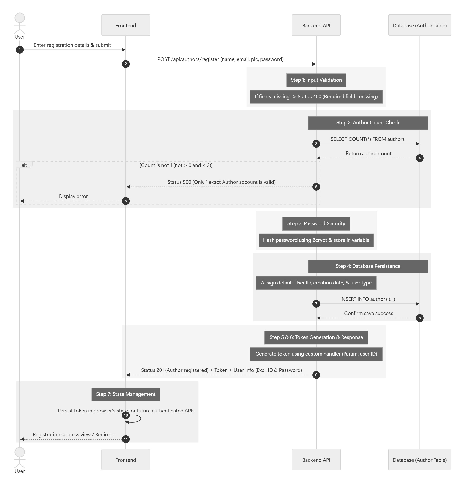
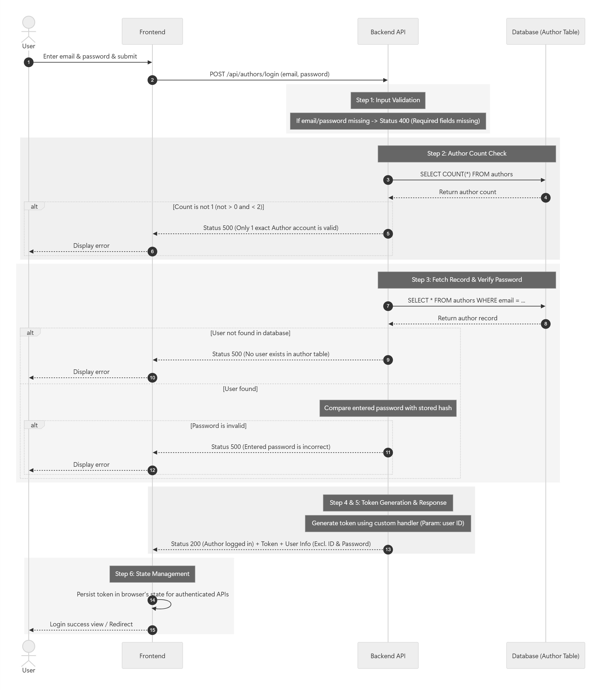

# Sprint 1: (11th to 13th November)  - User Account, Authentication & Authorization

<aside>

**Building APIs to manage account/profile, signing up and logging in using JWT and Bcrypt for efficient hashing.**

1. Register **Author** account, making sure no other account exists.
2. Login **Author** account.
3. Logout **Author** account.
4. Register **Viewer** account.
5. Login **Viewer** account.
6. Logout **Viewer** account.
7. Update **Author** account.
8. Update **Viewer** account.
9. Delete **Author** account.
10. Delete **Viewer** account.
</aside>

## 1.1 - Register Author Account

> **To sign up only one unique Author user account using email-password authentication with bcrypt hashing and JWT validation for authorization.

Endpoint: `/api/v1/author/signup`
Method:** POST
**Authentication:** False
> 

1. Enter **first** and **last name**, **email**, **profile picture** and **password**.
    1. If these fields aren’t inputted, **Status 400** → throw error where **required fields are missing**.
2. Fetch into **author table** and get the **count** of the fields.
    1. If **count** is not **more than 0** and **less than 2**, **Status 500** → throw error that only **1 exact Author account** is valid in this application.
3. **Hash** the password using **Bcrypt** and store the **hashed result** in a new variable.
4. Save the user information in the **Author** table of the database.
    1. **Unique user ID**, Account **creation date** and **type of user** is added by **default**.
5. **Generate token** using **custom handler** with user ID as the **parameter**, then return the **token** and user information excluding ID and Password to the frontend.
6. **Status 201** → Author account registered.
7. In frontend, **persist the token** in a browser’s **state** throughout the app, so that it will be efficient to use other APIs where authentication is required.

## 1.2 - Login Author Account

> **To login Author user account using email-password authentication using JWT where token automatically expires in a week.

Endpoint: `/api/v1/author/signin`
Method:** POST
**Authentication:** False
> 

1. Enter **email** and **password**.
    1. If these fields aren’t inputted, **Status 400** → throw error where **required fields are missing**.
2. Fetch into **author table** and get the **count** of the fields.
    1. If **count** is not **more than 0** and **less than 2**, **Status 500** → throw error that only **1 exact Author account** is valid in this application.
3. Fetch into **author table** and get the field.
    1. If user is not available in the **database**, **Status 500** → No user exists in **author** table.
    2. If the password is invalid, **Status 500** → throw error stating **entered password is incorrect**.
4. **Generate token** using **custom handler** with user ID as the **parameter**, then return the **token** and user information excluding ID and Password to the frontend.
5. **Status 200** → Author account logged in.
6. In frontend, **persist the token** in a browser’s **state** throughout the app, so that it will be efficient to use other APIs where authentication is required.

## 1.3 - Logout Author Account

> **To logout Author user account there is no API in the backend though we eliminate the persistent token in frontend from the browser’s asynchronous state.

Endpoint: `/api/v1/author/signout`
Method:** POST
**Authentication: True**