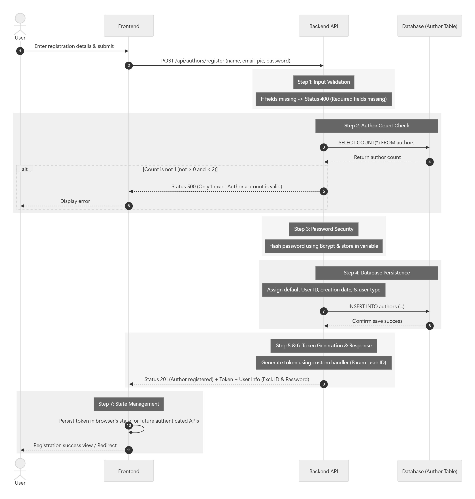
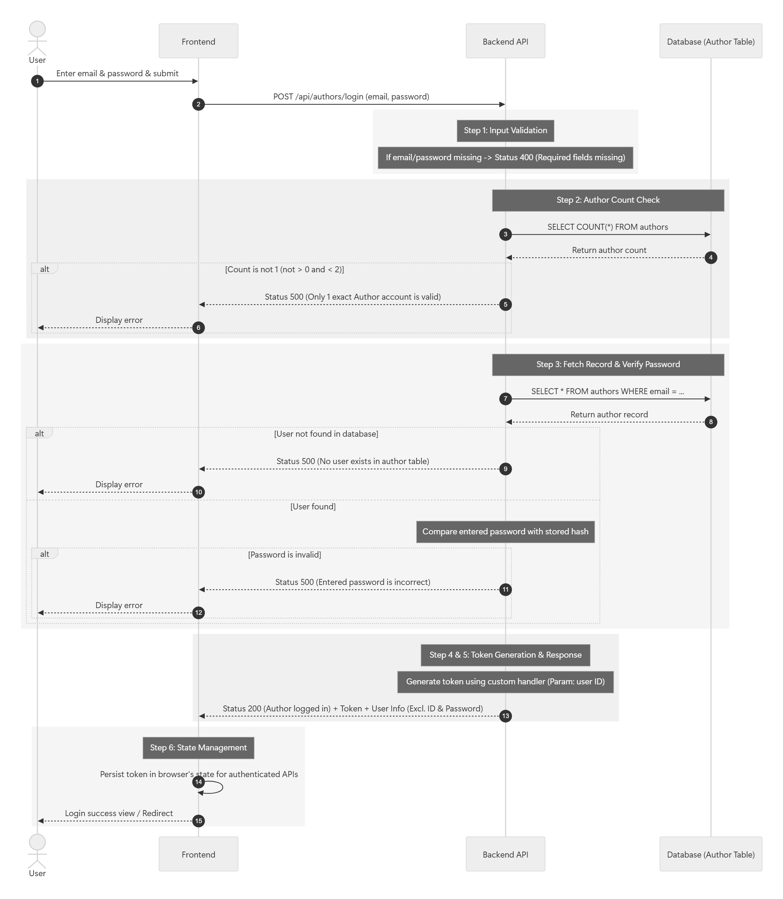
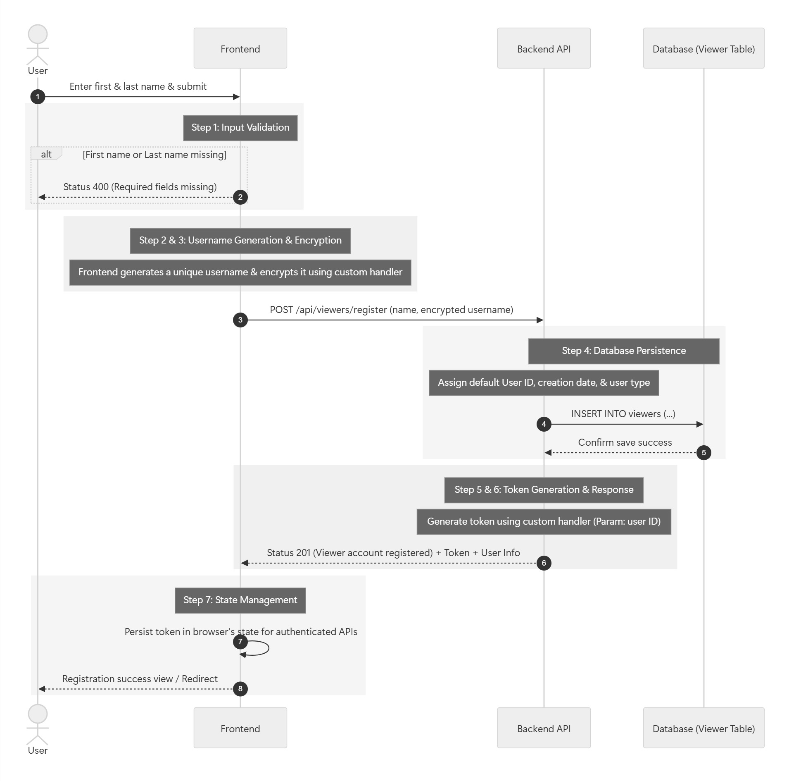
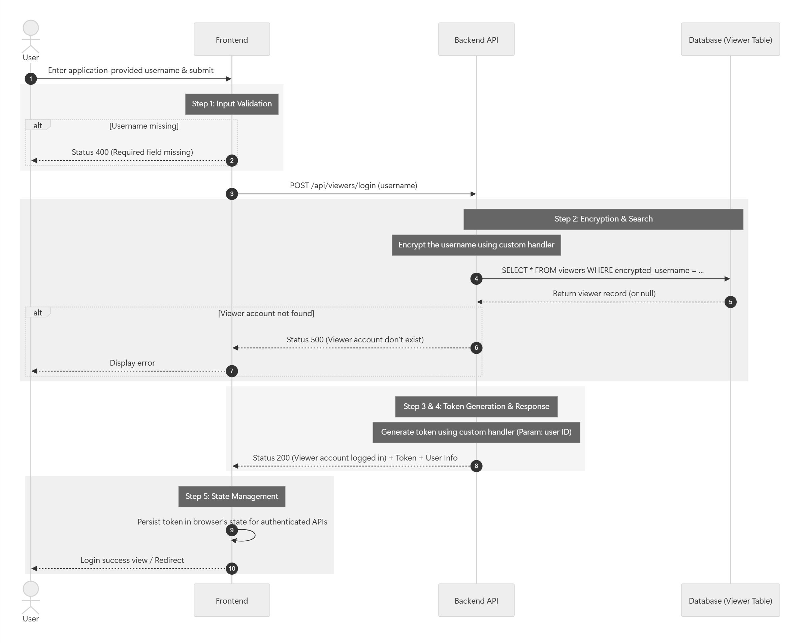
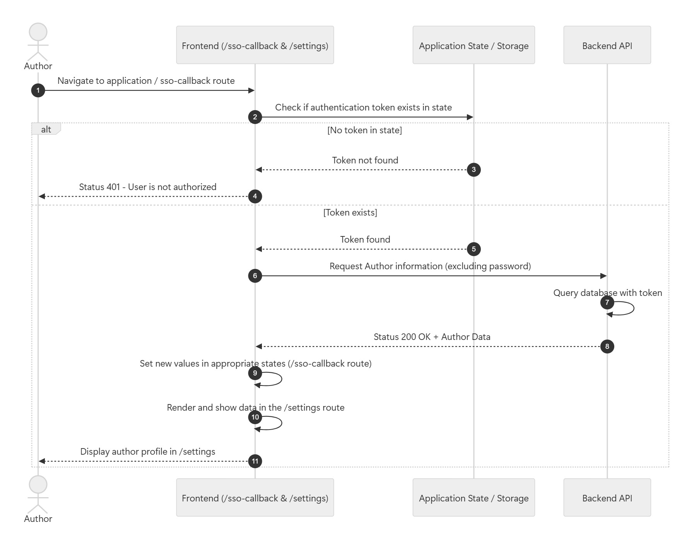
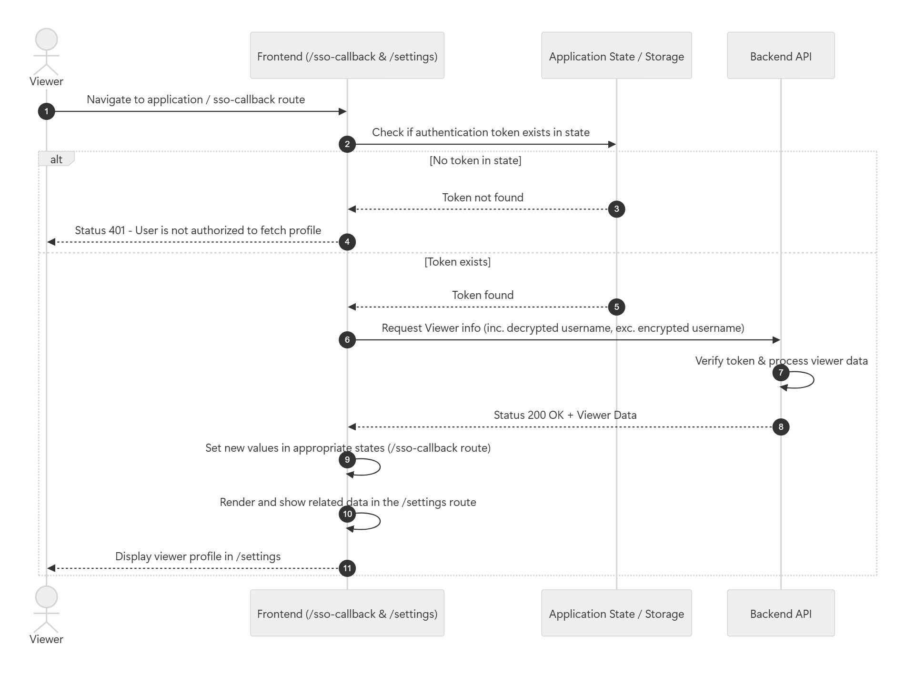
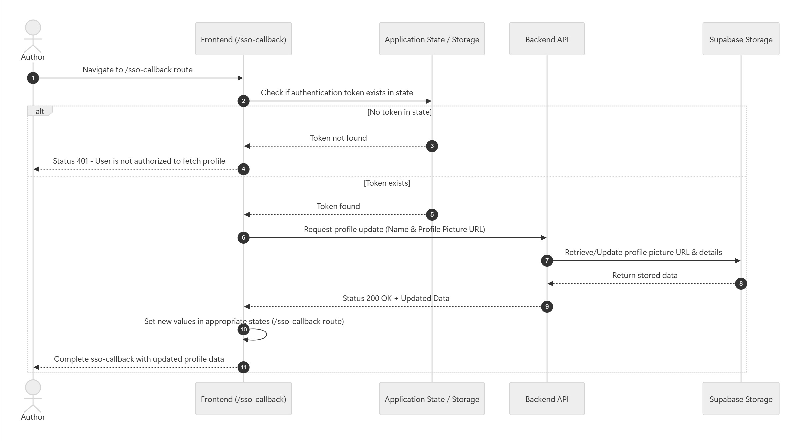
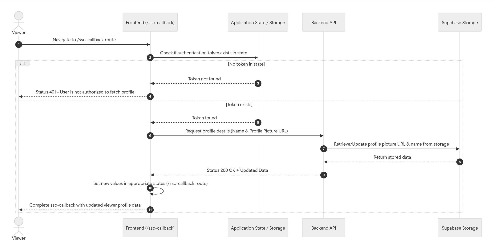
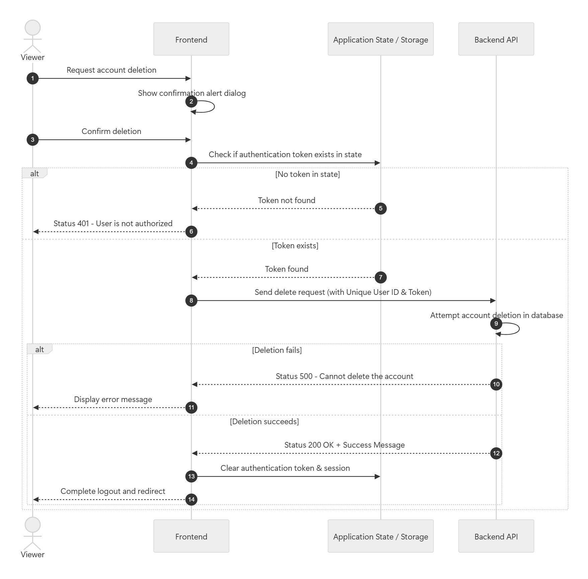

# Sprint 1: (15th to 18th November)  - User Account, Authentication & Authorization

<aside>

**Building APIs to manage account/profile, signing up and logging in using JWT and Bcrypt for efficient hashing.**

1. Register **Author** account, making sure no other account exists.
2. Login **Author** account.
3. Logout **Author** account.
4. Register **Viewer** account.
5. Login **Viewer** account.
6. Logout **Viewer** account.
7. Update **Author** account.
8. Update **Viewer** account.
9. Delete **Author** account.
10. Delete **Viewer** account.
</aside>

## 1.1 - Register Author Account

> **To sign up only one unique Author user account using email-password authentication with bcrypt hashing and JWT validation for authorization.

Endpoint: `/api/v1/author/signup`
Method:** POST
**Authentication:** False
> 

1. Enter **first** and **last name**, **email**, **profile picture** and **password**.
    1. If these fields aren’t inputted, **Status 400** → throw error where **required fields are missing**.
2. Fetch into **author table** and get the **count** of the fields.
    1. If **count** is not **more than 0** and **less than 2**, **Status 500** → throw error that only **1 exact Author account** is valid in this application.
3. **Hash** the password using **Bcrypt** and store the **hashed result** in a new variable.
4. Save the user information in the **Author** table of the database.
    1. **Unique user ID**, Account **creation date** and **type of user** is added by **default**.
5. **Generate token** using **custom handler** with user ID as the **parameter**, then return the **token** and user information excluding ID and Password to the frontend.
6. **Status 201** → Author account registered.
7. In frontend, **persist the token** in a browser’s **state** throughout the app, so that it will be efficient to use other APIs where authentication is required.

## 1.2 - Login Author Account

> **To login Author user account using email-password authentication using JWT where token automatically expires in a week.

Endpoint: `/api/v1/author/signin`
Method:** POST
**Authentication:** False
> 

1. Enter **email** and **password**.
    1. If these fields aren’t inputted, **Status 400** → throw error where **required fields are missing**.
2. Fetch into **author table** and get the **count** of the fields.
    1. If **count** is not **more than 0** and **less than 2**, **Status 500** → throw error that only **1 exact Author account** is valid in this application.
3. Fetch into **author table** and get the field.
    1. If user is not available in the **database**, **Status 500** → No user exists in **author** table.
    2. If the password is invalid, **Status 500** → throw error stating **entered password is incorrect**.
4. **Generate token** using **custom handler** with user ID as the **parameter**, then return the **token** and user information excluding ID and Password to the frontend.
5. **Status 200** → Author account logged in.
6. In frontend, **persist the token** in a browser’s **state** throughout the app, so that it will be efficient to use other APIs where authentication is required.

## 1.3 - Logout Author Account

> **To logout Author user account there is no API in the backend though we eliminate the persistent token in frontend from the browser’s asynchronous state.

Endpoint: `/api/v1/author/signout`
Method:** POST
**Authentication: True**

## 1.4 - Register Viewer Account

> **To sign up Viewer user account using first and last name with generating username, encrypting and saving it in the database for the authentication and JWT validation for authorization.

Endpoint: `/api/v1/viewer/signup`
Method:** POST
**Authentication:** False
>

1. Enter **first name** and **last name**.
    1. If these fields aren’t inputted, **Status 400** → throw error where **required fields are missing**.
2. Frontend will generate a **unique username**.
3. **Encrypt the username** with a **custom handler**.
4. Save the user information in the **Viewer** table of the database.
    1. **Unique user ID**, Account **creation date** and **type of user** is added by **default**.
5. **Generate token** using **custom handler** with user ID as the **parameter**, then return the **token** and user information to the frontend.
6. **Status 201** → **Viewer** account registered.
7. In frontend, **persist the token** in a browser’s **state** throughout the app, so that it will be efficient to use other APIs where authentication is required.

## 1.5 - Login Viewer Account

> **To login Viewer user account using unique username for authentication using JWT where token automatically expires in a span of two months.

Endpoint: `/api/v1/viewer/signin`
Method:** POST
**Authentication:** False
>

1. Enter **username** provided by the application.
    1. If username isn’t inputted, **Status 400** → throw error where **required field is missing**.
2. **Encrypt the username** and search in database by **mapping** it to the encrypted usernames.
    1. If not found, **Status 500** → throw error stating **Viewer** account don’t exist.
3. **Generate token** using **custom handler** with user ID as the **parameter**, then return the **token** and user information to the frontend.
4. **Status 200** → **Viewer** account logged in.
5. In frontend, **persist the token** in a browser’s **state** throughout the app, so that it will be efficient to use other APIs where authentication is required.

## 1.6 - Logout Viewer Account

> **To logout Viewer user account there is no API in the backend though we eliminate the persistent token in frontend from the browser’s asynchronous state.

Endpoint: `/api/v1/viewer/signout`
Method:** POST
**Authentication: True**
>

## 1.7 - Fetch Author Account details

> **Fetch Author user profile in the settings menu for readability.

Endpoint: `/api/v1/author/account`
Method:** GET
**Authentication: True**
>

1. Check whether the **Author** is logged in to the application using the **authenticated token**.
    1. If no **token** is in the state, **Status 401** → User is not authorized to fetch the profile.
2. Get all the information of the **Author** except password after logging in to the application.
3. Return the data to the **frontend**.
4. **Status 200** → then set new values in the appropriate **states** in the **`/sso-callback`** route of the frontend.
5. Show all the related data into the **`/settings`** route in the frontend.

## 1.8 - Fetch Viewer Account details

> **Fetch Viewer user profile in the settings menu for readability.

Endpoint: `/api/v1/viewer/account`
Method:** GET
**Authentication: True**
>

1. Check whether the **Viewer** is logged in to the application using the **authenticated token**.
    1. If no **token** is in the state, **Status 401** → User is not authorized to fetch the profile.
2. Get all the information including **decrypted username** of the **Viewer** except **encrypted username** after logging in to the application.
3. Return the data to the **frontend**.
4. **Status 200** → then set new values in the appropriate **states** in the **`/sso-callback`** route of the frontend.
5. Show all the related data into the **`/settings`** route in the frontend.

## 1.9 - Update Author Account

> **To update basic details like name and profile picture for the Author account.

Endpoint: `/api/v1/author/account`
Method:** PUT
**Authentication: True**
>

1.  Check whether the **Author** is authenticated to the application by verifying the **token**.
    1. If no **token** is in the state, **Status 401** → User is not authorized to fetch the profile.
2. Enter **name** and **profile picture url** from the **Supabase** storage.
    1. In frontend use **dialog** to type values and trigger this feature.
    2. If failed to delete the account, **Status 500** → Cannot update the **Author’s** account.
3. **Status 200** → Return the updated data to frontend and set new values in the appropriate **states** in the **`/sso-callback`** route of the frontend.

## 1.10 - Update Viewer Account

> **To update basic details like name and profile picture for the Viewer account.

Endpoint: `/api/v1/viewer/account`
Method:** PUT
**Authentication: True**
>

1.  Check whether the **Viewer** is authenticated to the application by verifying the **token**.
    1. If no **token** is in the state, **Status 401** → User is not authorized to fetch the profile.
2. Enter **name** and **profile picture url** from the **Supabase** storage.
    1. In frontend use **dialog** to type values and trigger this feature.
    2. If failed to delete the account, **Status 500** → Cannot update the **Viewer’s** account.
3. **Status 200** → Return the updated data to frontend and set new values in the appropriate **states** in the **`/sso-callback`** route of the frontend.

## 1.11 - Delete Author Account

> **To delete the Author account permanently.

Endpoint: `/api/v1/author/account`
Method:** DELETE
**Authentication: True**
>

1.  Check whether the **Author** is authenticated to the application by verifying the **token**.
    1. If no **token** is in the state, **Status 401** → User is not authorized to fetch the profile.
2. Delete the account using unique user ID.
    1. In frontend ask for confirmation using an **alert** **dialog**.
    2. If failed to delete the account, **Status 500** → Cannot delete the **Author’s** account.
3. **Status 200** → Return the delete message to the frontend then logout.

## 1.12 - Delete Viewer Account

> **To delete the Viewer account permanently.

Endpoint: `/api/v1/viewer/account`
Method:** DELETE
**Authentication: True**
>

1.  Check whether the **Viewer** is authenticated to the application by verifying the **token**.
    1. If no **token** is in the state, **Status 401** → User is not authorized to fetch the profile.
2. Delete the account using unique user ID.
    1. In frontend ask for confirmation using an **alert** **dialog**.
    2. If failed to delete the account, **Status 500** → Cannot delete the **Viewer’s** account.
3. **Status 200** → Return the delete message to the frontend then logout.