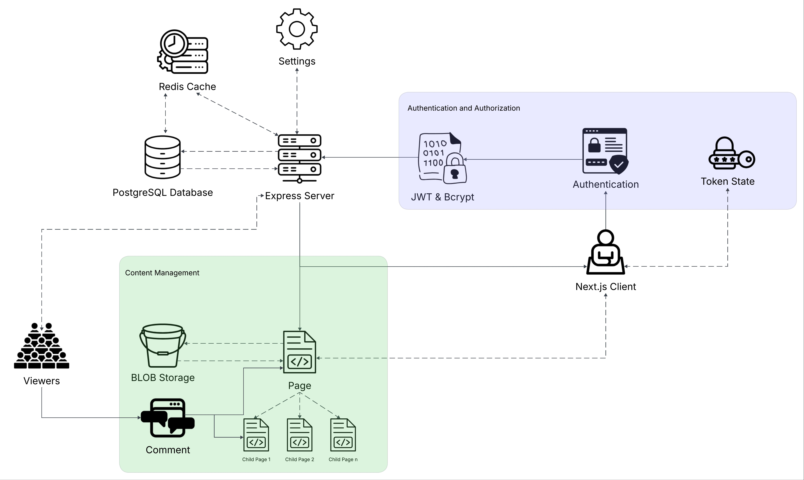
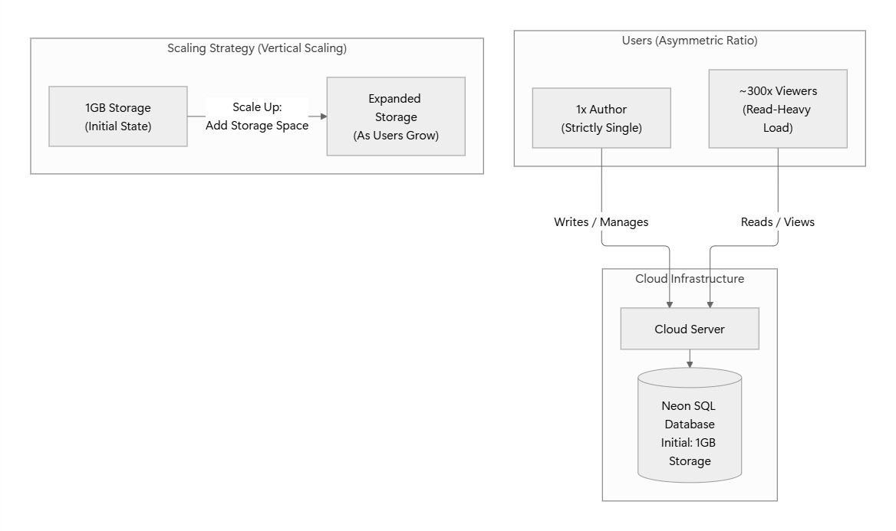
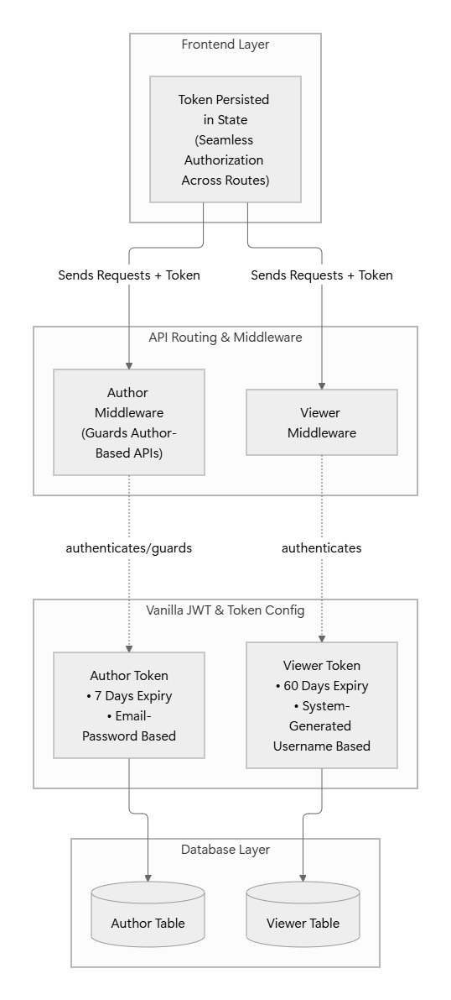
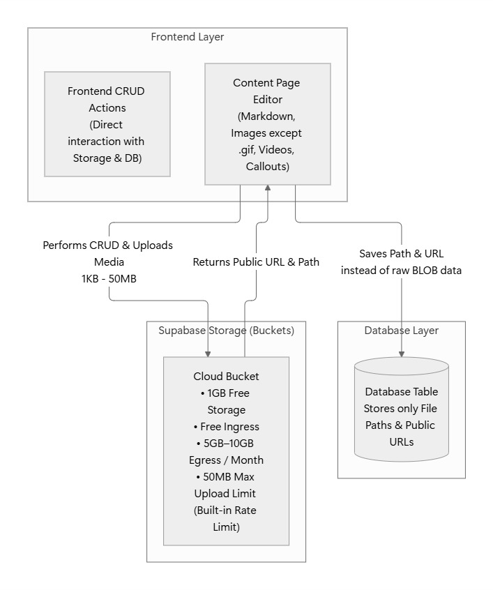
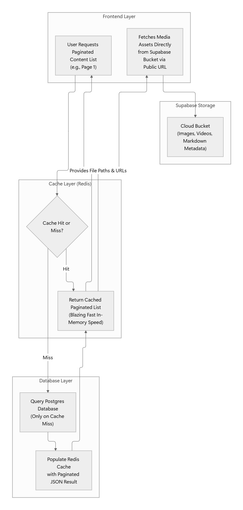
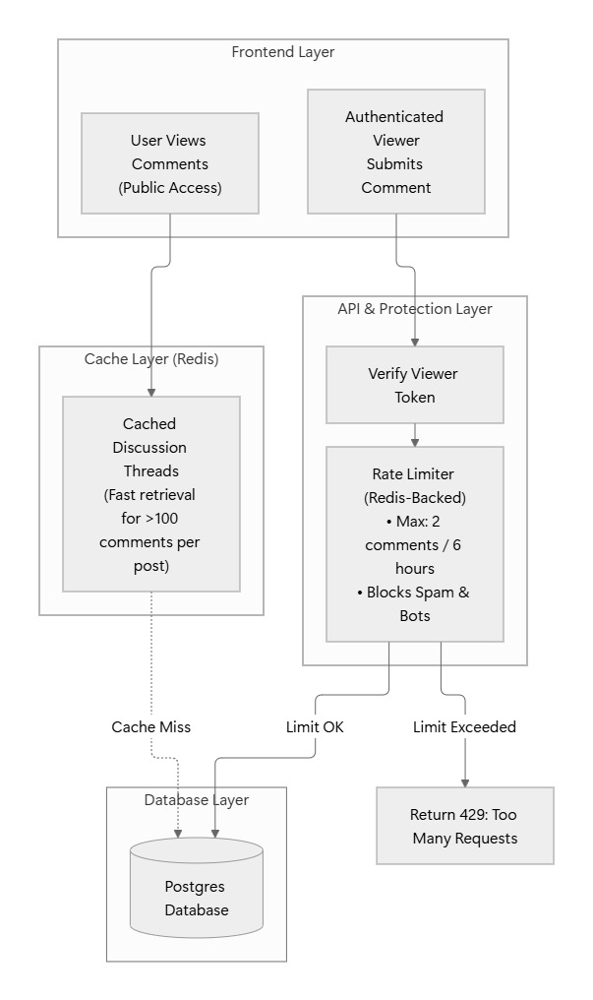

# 1 - High Level Diagram

1. Entire application is an idea of **Monolithic Architecture**.
2. There are two types of users: **Author** and **Viewer.**
    1. There can only be one strict **Author** user.
    2. Whereas, there can be N number of **Viewers**.
3. **Authentication** and **Authorization**, both are based on vanilla **JSON Web Token** and **Bcrypt** for hasing.
    1. For **Author**, we use Email and Password as authentication measure.
    2. For **Viewer**, we use Name and generate a unique username as authentication measure.
    3. In client, authentication **token** are stored in a persistent state.
4. A page is a markdown that stores the content posted by the **Author**.
    1. Content are mostly markdown texts, callouts, images, videos.
    2. Contents can be of a bigger size so we use a **BLOB storage** like (**AWS S3 Bucket** or **Supabase Storage**) to save the page’s content and **store the path** and **content link** to the **database**.
    3. A parent page can have multiple nested pages which are cascading by default when parent page makes any changes.
    4. For faster retrieval of every types of pages we use **Redis** as the **caching** server.
5. **Viewers** can not only read a post content but also comment on a post in the **Discussion** section.
    1. If a Viewer is using profanity or slurs on comments of the post, Author can **ban** that particular **Viewer** from commenting.
    2. **Author** can also reply to the **Viewers** comment ****in the **Discussion** section.
    3. For faster retrieval every comments of a page we use **Redis** as the **caching** server.
    4. **Author** can also send private messages to a **Viewer**, about new release change logs, news, personal messages, etc.
6. **Settings** is the management place for all types of users.
    1. **Author** can see all the data, trash, viewers, messages, comments, replies on comments, banned users, delete account options and logout option.
    2. **Viewers** can see all the viewers, messages from author, their own comments, delete account option and logout option.
    3. For faster retrieval we use **Redis** as the **caching** server for all settings features.

# 2 - Scaling Users

1. There are two types of users:
    1. **Author**
    2. **Viewer**
2. There is only one strict **Author** whereas there can be more than 100 **Viewers**.
3. Considering there are about 300 **Viewers** and only 1 **Author** we can conclude that we can choose **Vertical scaling** as the best option to **scale up**.
4. A SQL database with **1GB** of storage is enough to store accounts of users for this project.
5. As users grow and **1GB** seems non feasible, we scale up by adding more storage space in the database.
6. We will require a cloud to host the database over a server, so we use **Neon** as the best option that is providing everything we require on the **free tier**.

# 3 - Authentication & Authorization

1. Authentication is heavily based on **vanilla JWT**, where **Author** and **Viewer** doesn’t have the same **middleware**.
2. **Author** has a different table whereas **Viewer** has the different table in the database, so this allows **efficiency and protection** when it comes to guarding **Author** based APIs.
3. For **Author token expiry limit** is **7 days**, but for **Viewer token expiry limit** is **60 days**. 
4. **Viewer** has **higher limit** because they do not use **email-password** based authentication like **Author**. 
5. **Viewer’s token** is generated based on the **unique username** given by the system.
6. On frontend, the **token is persisted in a state**, allowing **seamless** authorization throughout different **routes**.

# 4 - Managing a content page

1. A page consists of **markdown data**, that involves **texts with some hyper text markup styling**, **images** of any type (except .gif), **videos** and **callouts**.
2. This type of data as whole can be of any size, within the range of **1KB** to **50MB**. 
3. Storing **BLOB data** in the database would be a **hassle** and **inefficient**, as it will cause the database to get full resulting in lack of storage management.
4. Instead, use **buckets** from a **cloud service** that provides appropriate **storage**, **ingress**, and **egress**.
5. **Supabase Storage** seems to be **feasible** as it deals with the data management **over the frontend**, resulting in efficiency to perform **CRUD** actions on frontend itself without hitting the **server API** or **database**.
6. On the **free tier**, **1GB of Storage** is available, **free ingress**, **5GB** to **10GB** of **egress per month** and **50MB of upload limit**.
7. Since there is a **upload limit**, it saves **server from implementing a rate limit handler** for the upload.
8. Store **path** and **public url** in the database instead of the entire data, so that it becomes simpler to **manage page contents** in the frontend.

# 5 - Reading content pages heavily

1. Considering there are over **300 users**, all fetching **paginated** **lists** of content pages at the same time, it will be **heavy on database** for fetching queries.
2. Instead of fetching same lists every time from **database**, save each paginated lists on the **cache server** after first miss. 
3. Using **Redis Cache** will result in applying **less pressure** on **database** and **retrieving speed** will be fast and efficient as well.
4. The contents of the page itself will be fetched from the **database**, as it is connected to **Supabase Storage** and it will be fetched from the frontend. So the **time** isn’t determined when it comes to **retrieving from the bucket** from the **public url** of that page.

# 6 - Discussions of a Post

1. Anyone can see **discussions/comments** of a post depending on the type of the page.
2. **Multiple discussions are always connected to a page**, though **retrieving is public**, **Viewer** must be **authenticated** to **send a comment** over a post.
3. Adding a **rate-limit** over discussion threads seems feasible as a **Viewer** or a **bot** might **spam** comments which will be terrible for the database to handle that much of **writes simultaneously**.
4. So applying a **rate-limit rule**, where a **Viewer** can only **send 2 comments** in every **6 hours**.
5. Considering that might be **>100** discussions over a post, a **caching server** like **Redis** seems feasible when it comes to **retrieving** those comments as quickly as the contents are loaded alongside.

# 7 - Features where Caching is a must

1. When it comes to retrieving and data is huge, using caching server like Redis is a good option.
2. This results in opting chances of slower retrieval duration which we get from querying database directly.
3. Features like **Messages**, **Comments/Discussions**, **List of Viewers**, **List of Pages** requires **heavy reading** where **Redis** is feasible to **retrieve data** in much **quicker time** providing efficiency in fetching same data everytime.

# 8 - Tech Stack
1. **Language**: TypeScript.
2. **Frontend**: Vite, React.js, TailwindCSS.
    1. **Libraries and Dependencies**: React-Router-Dom, Supabase, Axios, Zustand, ShadCN.
3. **Backend**: Node.js, Express.
    1. **Libraries and Dependencies**: Prisma, JsonWebToken, Bcryptjs, CORS, Dotenv.
4. **Database**: PostgreSQL
5. **Caching**: Redis
6. **Deployment**:
    1. **Database**: Neon 
    2. **Frontend**: Vercel
    3. **Backend**: Render